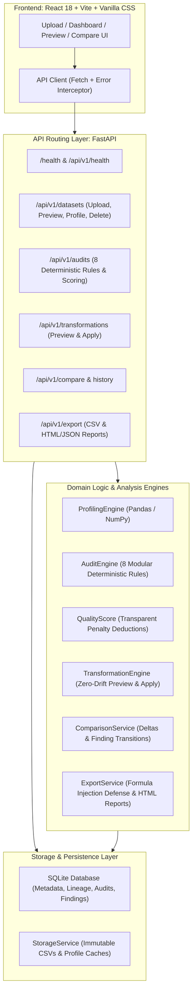

# DataLens — Dataset Quality Auditor

DataLens is a web application designed to help data analysts, students, researchers, and machine learning practitioners inspect, profile, audit, clean, and verify tabular datasets (CSV) through a transparent, reproducible workflow.

## Core Workflow

```
Upload CSV ──► Profile Dataset ──► Deterministic Quality Audit ──► Inspect Findings
                                                                          │
Export Cleaned CSV ◄── Compare Versions ◄── Re-audit ◄── Apply Transformation ◄── Preview Changes
& Audit Report
```

1. **Upload & Validate**: Upload tabular CSVs with file-size enforcement (10MB limit), encoding auto-detection (UTF-8, Latin-1, CP1252), and duplicate/empty header sanitization while preserving leading zeros.
2. **Profile**: Compute descriptive summary statistics for numerical (mean, median, std, quartiles, IQR), categorical (frequencies, unique ratios), datetime, and boolean columns.
3. **Audit**: Run 8 deterministic quality checks with transparent, configurable thresholds (missing values, exact duplicates, constant columns, high cardinality, IQR outliers, type inconsistency, target-class imbalance, potential feature leakage).
4. **Inspect Findings**: Review prioritized issues with concrete numerical evidence, severity ratings, and contextual recommendations in a slide-out drawer.
5. **Non-Mutating Preview**: Preview the exact impact of a cleaning operation before applying it, viewing affected row counts and before/after cell diffs.
6. **Versioned Transformation**: Apply cleaning operations (median imputation, mode imputation, duplicate removal, constant column drop) to create immutable child versions (`v1` ➔ `v2` ➔ `v3`).
7. **Re-Audit & Compare**: Compare any two versions side-by-side with score deltas (+/-), deduction reductions, metric deltas, findings transitions (`resolved`, `unresolved`, `new`), and schema changes.
8. **Export**: Download the cleaned CSV version (with optional spreadsheet formula injection defense) and standalone self-contained HTML or JSON audit reports.

---

## System Architecture & Module Boundaries

DataLens is built with clear separation of concerns across presentation, API routing, deterministic business logic, and transactional storage:



### Module Boundaries
- `backend/app/api/`: Handles HTTP serialization, query parameter validation, and status codes. Delegates all business logic to service layer.
- `backend/app/audit/`: Pure computational engine for statistical profiling (`profiling.py`), 8 modular deterministic quality rules (`rules/`), and transparent quality scoring (`scoring.py`). Has zero dependency on HTTP layer.
- `backend/app/services/`: Coordinates orchestration between database models and disk storage (`dataset_service.py`, `cleaner.py`, `comparison.py`, `export.py`).
- `backend/app/db/`: Database session lifecycle and table schemas with enforced foreign key cascading (`PRAGMA foreign_keys = ON;`).
- `backend/app/core/`: Application settings, environment variable bindings, and uniform error envelope registration (`errors.py`).
- `frontend/src/api/`: Centralized HTTP client with automatic network failure handling and error envelope parsing.
- `frontend/src/components/`: Modular React components styled exclusively with standard, maintainable CSS (no Tailwind CSS).

---

## Technology Stack

- **Frontend**: React 18, Vite, JavaScript, vanilla CSS (responsive layout, accessible tables, no Tailwind CSS).
- **Backend**: Python 3.10+ (tested on Python 3.14 / Arch Linux), FastAPI, Uvicorn, Pydantic v2.
- **Data Engine**: Pandas and NumPy.
- **Persistence**: SQLite with SQLAlchemy ORM (`PRAGMA foreign_keys = ON;`) for metadata, version tracking, audit records, and transformation logs.
- **Testing**: pytest and FastAPI TestClient (91 automated tests passing).

---

## 8 Deterministic Quality Audit Rules

| Rule ID | Rule Name | Description & Heuristic | Severity Tiers |
| :--- | :--- | :--- | :--- |
| `rule_missing_values` | Missing Values | Detects null or empty cells per column | High (≥20%), Medium (5-20%), Low (<5%) |
| `rule_exact_duplicates` | Exact Duplicate Rows | Detects identical rows across all columns | High (≥10%), Medium (<10%) |
| `rule_constant_columns` | Constant Columns | Identifies zero-variance columns | High (all-null or 1 value), Medium (1 value + nulls) |
| `rule_high_cardinality` | High Cardinality | Flags potential ID columns (>90% uniqueness ratio, count ≥ 15) | Low (uncertainty note: heuristic indicator) |
| `rule_numeric_outliers` | Numeric Outliers | Tukey's IQR fences: `[Q1 - 1.5*IQR, Q3 + 1.5*IQR]` | Medium (≥5% outliers), Low (<5%) |
| `rule_type_consistency` | Type Inconsistency | Mixed types preventing safe coercion without data loss | High (≥5% unparseable), Medium (<5%) |
| `rule_class_imbalance` | Class Imbalance | Evaluates user-selected or auto-detected target column | High (<5% minority or >10:1 ratio), Medium (<20% or >4:1) |
| `rule_potential_leakage`| Potential Leakage | Near-perfect target-feature (\|r\| ≥ 0.98) or duplicate features | High (target corr ≥ 0.98), Medium (duplicate col ≥ 0.999) |

---

## Transparent Quality Score (0–100)

DataLens computes a bounded 0–100 dataset quality score derived from component penalty deductions:
- **Missingness penalty**: Up to 30.0 points.
- **Duplicate rows penalty**: Up to 25.0 points.
- **Constant columns penalty**: Up to 20.0 points.
- **Type inconsistency penalty**: Up to 15.0 points.
- **Anomalies & heuristics penalty**: Up to 10.0 points.

**Method Version**: `1.0`. Every audit includes an explicit disclaimer: *The quality score evaluates implemented deterministic checks only and does not provide an absolute guarantee of dataset correctness or real-world fitness.*

---

## Local Development Setup

### Prerequisites
- Python 3.10+ (Arch Linux users: use `.venv` virtual environment)
- Node.js 18+ and npm
- Git

### 1. Backend Setup

```bash
# From repository root:
# 1. Create and activate virtual environment
python3 -m venv .venv
source .venv/bin/activate

# 2. Install backend dependencies
pip install -r backend/requirements.txt

# 3. Configure environment variables
cp .env.example .env

# 4. Run backend API server
uvicorn backend.app.main:app --host 127.0.0.1 --port 8000 --reload
```

Backend will be available at `http://127.0.0.1:8000` (interactive OpenAPI documentation at `http://127.0.0.1:8000/docs`).

### 2. Frontend Setup

```bash
# From repository root:
cd frontend

# 1. Install dependencies
npm install

# 2. Start Vite development server
npm run dev
```

Frontend will be available at `http://localhost:5173`.

### 3. Production Build

```bash
cd frontend
npm run build
```

Production assets will be output to `frontend/dist/`.

### 4. Running the Test Suite

```bash
# Run all 88 unit, integration, and E2E tests:
.venv/bin/pytest backend/tests -v
```

---

## Demo Dataset & Quick Walkthrough

A pre-crafted dataset with known defects across all 8 audit rules is located at [`sample_datasets/demo_dirty_dataset.csv`](sample_datasets/demo_dirty_dataset.csv).

See [`sample_datasets/README.md`](sample_datasets/README.md) for a detailed breakdown of all deliberate anomalies.

### Quick Verification Walkthrough:
1. **Upload**: Drag and drop `sample_datasets/demo_dirty_dataset.csv`.
2. **Audit**: Run quality audit and observe initial Quality Score (~70/100).
3. **Inspect**: Click on the Duplicate Rows finding to inspect sample row indices in the structured evidence drawer.
4. **Preview & Clean**:
   - Open **Clean & Transform** ➔ **Remove Exact Duplicate Rows** ➔ Preview diff (1 row removed) ➔ Apply (creates Version 2).
   - **Impute Missing Numeric Values (Median)** on `salary` ➔ Preview diff ➔ Apply (creates Version 3).
   - **Drop Constant Column** on `country` ➔ Preview diff ➔ Apply (creates Version 4).
5. **Compare**:
   - Open **Compare Versions**.
   - Compare Baseline (`v1`) against Cleaned (`v4`).
   - Observe score increase (+18 points), duplicate & missing cell improvements, and the **Resolved Findings** tab.
6. **Export**:
   - Download the cleaned CSV (with formula protection).
   - Download the standalone self-contained HTML audit report.

---

## Core Invariants

1. **Deterministic Logic**: Statistical checks, scores, and transformations are deterministic algorithms implemented with Pandas and NumPy. No external LLMs are invoked for profiling or cleaning.
2. **Upload Immutability**: Original uploaded files are preserved immutably. Transformations write new child versions (`v2`, `v3`).
3. **Preview/Apply Parity**: Non-mutating preview and permanent apply invoke the identical underlying `TransformationEngine` code to eliminate simulation discrepancy.
4. **Formula Injection Sanitization**: Exporting with `spreadsheet_safe=True` prefixes leading `=`, `+`, `-`, `@`, `\t`, and `\r` with `'` to neutralize CSV/DDE injection vulnerabilities in spreadsheet applications.
5. **Cascade Integrity & Zero Orphan Storage**: Deleting a dataset safely removes its SQLite database records, version files, and disk-cached profile files. If any database commit fails during dataset or version creation, the newly created disk file is immediately purged during rollback.
6. **Uniform Error Envelope**: All API errors (business exceptions, HTTP errors, validation errors) return a standardized `{ "error": "...", "message": "...", "details": { ... } }` payload.
7. **Deletion Confirmation**: Deletion is guarded by an accessible in-app modal with clear warning about permanent cascade effects before execution.

---

## Production Deployment & Hosting Guide

> [!NOTE]
> **Deployment Status**: External cloud hosting deployment is **NOT verified** in this repository because remote cloud provider access and credentials (e.g., AWS, GCP, Render, Vercel) are not provided.
> Local development, backend test execution (88/88 passed), daemonized server execution, and production frontend compilation (`npm run build`) are **100% verified**.

If you wish to deploy DataLens to a production Linux server or container platform, follow the exact manual steps below.

### 1. Docker & Docker Compose Deployment (Recommended for Containers)

A multi-stage `Dockerfile` and `docker-compose.yml` are provided in the repository root:

```bash
# Build and run container in detached mode:
docker compose up --build -d

# Verify health status:
curl http://localhost:8000/health
```

#### Persistent Storage Behavior in Containerized Environments
- **Important**: SQLite database files (`/app/storage/datalens.db`) and versioned CSV files (`/app/storage/*.csv`) **must** be stored on a persistent volume mount (such as the `datalens_data` named volume in `docker-compose.yml` or a Kubernetes PersistentVolumeClaim).
- **Ephemeral Disks**: Storing `./storage` on an ephemeral container layer will cause all uploaded datasets, versions, and audit history to be permanently lost upon container recreation or node rescheduling.

### 2. Linux VPS Deployment (Systemd + Nginx)

For standard Linux virtual private servers (Ubuntu, Debian, Arch Linux):

#### Step A: Systemd Backend Service
Create `/etc/systemd/system/datalens.service`:
```ini
[Unit]
Description=DataLens FastAPI Backend Service
After=network.target

[Service]
Type=simple
User=www-data
WorkingDirectory=/var/www/datalens
EnvironmentFile=/var/www/datalens/.env
ExecStart=/var/www/datalens/.venv/bin/uvicorn backend.app.main:app --host 127.0.0.1 --port 8000 --workers 2
Restart=always
RestartSec=5

[Install]
WantedBy=multi-user.target
```

Enable and start the service:
```bash
sudo systemctl daemon-reload
sudo systemctl enable --now datalens
```

#### Step B: Nginx Reverse Proxy & Static Asset Server
Build the frontend production bundle:
```bash
cd /var/www/datalens/frontend
npm install
npm run build
```

Configure Nginx `/etc/nginx/sites-available/datalens`:
```nginx
server {
    listen 80;
    server_name datalens.example.com;

    # Serve built frontend static assets
    root /var/www/datalens/frontend/dist;
    index index.html;

    location / {
        try_files $uri $uri/ /index.html;
    }

    # Proxy API and health requests to Uvicorn
    location /api/ {
        proxy_pass http://127.0.0.1:8000/api/;
        proxy_set_header Host $host;
        proxy_set_header X-Real-IP $remote_addr;
        proxy_set_header X-Forwarded-For $proxy_add_x_forwarded_for;
        proxy_set_header X-Forwarded-Proto $scheme;
    }

    location /health {
        proxy_pass http://127.0.0.1:8000/health;
        proxy_set_header Host $host;
    }

    client_max_body_size 12M;
}
```

Enable site and restart Nginx:
```bash
sudo ln -s /etc/nginx/sites-available/datalens /etc/nginx/sites-enabled/
sudo nginx -t && sudo systemctl reload nginx
```

---

## Limitations & MVP Boundaries

- **Single-User MVP**: Operates without authentication, user accounts, or multi-tenant isolation.
- **Storage Scope**: Uses local filesystem storage and SQLite (`storage/datalens.db`). Not intended for multi-node cloud clusters without a shared persistent volume or object store.
- **Tabular CSV Only**: Accepts standard tabular CSV files; Excel (`.xlsx`), Parquet, and unstructured formats are out of scope for the MVP.
- **Heuristics Disclaimer**: Class imbalance, feature leakage, and outlier detection rely on statistical heuristics (IQR, correlation coefficients). They indicate potential issues for domain-expert inspection rather than mathematical certainty.
- **Cloud Deployment**: As stated above, cloud deployment is not verified due to the lack of external cloud infrastructure access. Local production builds and Docker configurations are verified.
