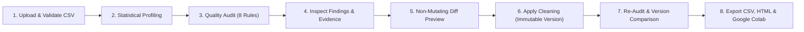
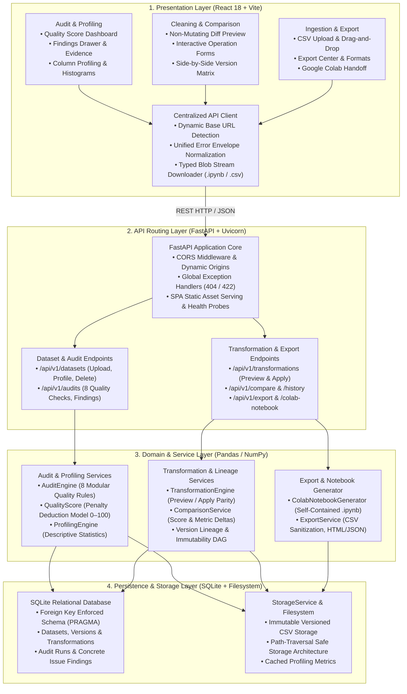
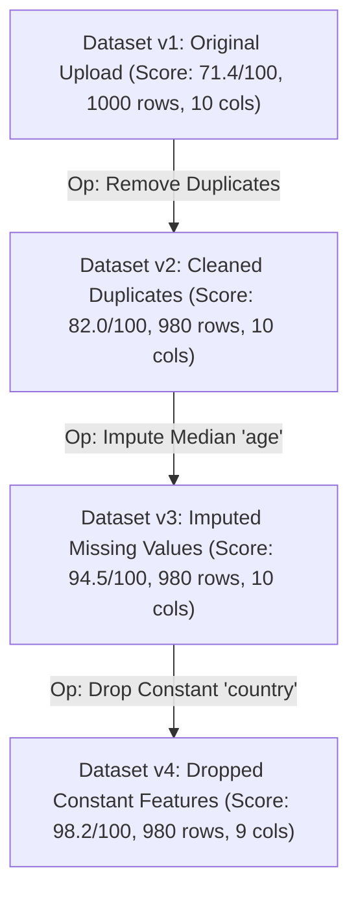

# DataLens — Tabular Dataset Quality Auditor & Cleaning Engine

[](https://fastapi.tiangolo.com)
[](https://react.dev)
[](https://pandas.pydata.org)
[](https://sqlite.org)
[](https://docs.pytest.org)
[](LICENSE)

---

### 📺 Project Demo Video & Presentation Link
> [!IMPORTANT]
> **Submission Video & Artifacts**:  
> **Google Drive Link:** [https://drive.google.com/drive/folders/YOUR_DATA_LENS_DEMO_FOLDER_LINK_HERE](https://drive.google.com/drive/folders/YOUR_DATA_LENS_DEMO_FOLDER_LINK_HERE?usp=sharing)  
> **Live Working Link :**https://data-lens-pi-two.vercel.app

---

## Table of Contents

1. [Problem Statement](#1-problem-statement)
2. [Target Users](#2-target-users)
3. [The Solution: DataLens](#3-the-solution-datalens)
4. [Key Features](#4-key-features)
5. [System Architecture & Design](#5-system-architecture--design)
   - [End-to-End Workflow & Data Flow](#end-to-end-workflow--data-flow)
   - [System Component Architecture](#system-component-architecture)
   - [Version Lineage & Immutability Model](#version-lineage--immutability-model)
6. [The 8 Deterministic Quality Audit Rules](#6-the-8-deterministic-quality-audit-rules)
7. [Transparent Quality Score (0–100)](#7-transparent-quality-score-0100)
8. [Technology Stack](#8-technology-stack)
9. [Environment Variables](#9-environment-variables)
10. [Local Setup & Installation Guide](#10-local-setup--installation-guide)
11. [Demo Dataset & Guided Walkthrough](#11-demo-dataset--guided-walkthrough)
12. [Automated Testing & Quality Assurance](#12-automated-testing--quality-assurance)
13. [Production Deployment Guide](#13-production-deployment-guide)
    - [Docker & Docker Compose (Containerized)](#docker--docker-compose-containerized)
    - [Linux VPS (Systemd + Nginx Reverse Proxy)](#linux-vps-systemd--nginx-reverse-proxy)
14. [Core Invariants & Limitations](#14-core-invariants--limitations)
15. [Future Plans for the Project](#15-future-plans-for-the-project)

---

## 1. Problem Statement

In data science, machine learning, and business intelligence, an estimated **80% of project time is spent discovering, investigating, and cleaning dirty data**. 

Real-world tabular datasets (especially CSV exports from CRM tools, transactional databases, and public repositories) are routinely afflicted with:
- **Silent data corruption**: Mixed types in numerical columns where string errors (e.g., `"N/A"`, `"-"`, `"unknown"`) cause silent conversion to null or crash downstream pipelines.
- **Hidden null values and duplicate records**: Duplications distort statistical distributions, introduce sample bias, and artificially inflate evaluation metrics.
- **Data leakage and zero-variance features**: Features with near-perfect correlation with the target variable leak test information, while constant columns waste computation and break linear models.
- **The "Black-Box" Cleaning Dilemma**: Existing automated data cleaning tools either mutate datasets invisibly without explaining *why* records were altered, or require data scientists to write repetitive, error-prone manual Python profiling scripts from scratch.
- **Lack of Lineage & Diff Verification**: Analysts rarely have a reproducible way to preview the exact cell-level changes of a cleaning operation before applying it, leading to irreversible loss of source data.

---

## 2. Target Users

DataLens is purpose-built for practitioners who need transparency, speed, and safety in data preparation:

1. **Data Analysts & Business Intelligence Specialists**:
   - Inspect raw business tabular exports before feeding them into dashboards or spreadsheets.
   - Benefit from automated spreadsheet-safe CSV exports that neutralize formula injection vulnerabilities.
2. **Students & Machine Learning Beginners**:
   - Learn standard data quality audits, understand *why* their classification or regression models underperform, and observe the tangible impact of median/mode imputation on summary statistics.
3. **Researchers & Applied Scientists**:
   - Require immutable dataset versioning, reproducible transformation histories, and standalone, publication-ready HTML audit reports documenting exact dataset lineage.
4. **Machine Learning Engineers & Practitioners**:
   - Audit and clean datasets locally, then seamlessly export a prepared starter notebook directly into **Google Colab** to train models without tedious data-loading boilerplate.

---

## 3. The Solution: DataLens

**DataLens** is an open-source, deterministic tabular dataset quality auditor, non-mutating previewer, and cleaning engine. It provides a complete, transparent, and reproducible bridge between dirty raw CSV files and production-ready machine learning workflows.

Rather than relying on non-deterministic external LLMs or black-box auto-clean scripts:
- DataLens applies **8 transparent, rule-based statistical checks** (implemented with Pandas and NumPy).
- It scores datasets on an **explainable 0–100 Quality Scale** backed by transparent penalty formulas.
- It provides a **non-mutating preview engine**: you see the exact row counts and cell diffs *before* a single byte is saved to disk.
- It guarantees **immutability**: original uploads (`v1`) are never overwritten; every cleaning operation produces a new version (`v2`, `v3`) with parent-child lineage tracking.
- It provides **side-by-side version comparison**: track score increases, metric deltas, and resolved vs. unresolved issues.
- It bridges to modeling via **Google Colab handoff**: export a structured `.ipynb` notebook tailored to your dataset version and launch Colab with one click.

---

## 4. Key Features

- 📁 **Robust CSV Upload & Auto-Sanitization**:
  - Enforces strict 10MB file-size limits.
  - Automatically detects encodings (`UTF-8`, `Latin-1`, `CP1252`).
  - Safely deduplicates collision headers and preserves critical leading zeros (e.g., ZIP codes, ID numbers).
- 📊 **Interactive Deep Column Profiling**:
  - Detailed summary statistics for numerical (`mean`, `median`, `std`, `min`, `IQR`, `quartiles`), categorical (`top frequencies`, `unique ratios`), datetime, and boolean columns.
  - Custom SVG histograms with annotated quartile markers and category distribution frequency bars.
- 🛡️ **8 Modular Deterministic Quality Rules**:
  - Automated detection of missing values, exact duplicates, constant columns, high cardinality keys, Tukey IQR outliers, type inconsistency, class imbalance, and target leakage.
- 💯 **Explainable Quality Score (0–100)**:
  - Transparent component penalties (missingness, duplicates, constant columns, mixed types, heuristics) with method versioning (`v1.0`).
- 🔍 **Actionable Findings & Evidence Drawer**:
  - Issues prioritized by severity (`High`, `Medium`, `Low`).
  - Slide-out inspection drawer with concrete numerical evidence, affected row indices, and one-click recommended fix triggers.
- ⚡ **Non-Mutating Cleaning Preview**:
  - Preview before applying: see exact rows removed, cells modified, and side-by-side before/after values with zero risk to original data.
- 🔄 **Immutable Versioning & Lineage**:
  - Cleaning creates immutable child versions (`v1` ➔ `v2` ➔ `v3`). Original source data is permanently preserved.
- ⚖️ **Side-by-Side Version Comparison**:
  - Compare any two versions to inspect score deltas (`+18.5 pts`), penalty reduction breakdowns, column drops, and findings transitions (`resolved`, `unresolved`, `new`).
- 📦 **Multi-Format Export Center**:
  - Export cleaned CSVs with optional **Spreadsheet Formula Injection Defense** (neutralizes `=`, `+`, `-`, `@` macros).
  - Standalone self-contained HTML audit reports (interactive, printable, zero external CSS dependencies) and machine-readable JSON reports.
- 🚀 **Self-Contained Google Colab Integration**:
  - Download a ready-to-run Jupyter notebook (`.ipynb`, nbformat v4.5) customized to your active dataset version with the exact dataset embedded as a base64 payload. Run all cells in Colab with zero setup—no separate CSV upload or server connection needed!
  - Single-click launcher opening official Google Colab in a new browser tab.
- 🗑️ **Safe Cascade Deletion**:
  - Accessible confirmation modal guaranteeing complete cleanup of SQLite records, child versions, disk CSVs, and profile caches without orphaned files.

---

## 5. System Architecture & Design

### End-to-End Workflow & Data Flow



> **Workflow Explanation**:  
> The diagram above illustrates the typical end-to-end user lifecycle in DataLens. A user begins by uploading a raw CSV, which is validated and stored as an immutable `v1` version. Profiling and audit engines immediately compute descriptive statistics and evaluate the 8 deterministic quality checks. When issues are discovered, the user inspects concrete evidence and runs a non-mutating preview of the proposed fix. Once satisfied, the transformation creates a new child version (`v2`), triggers an automated re-audit, allows side-by-side version comparison, and enables exporting to CSV, HTML audit reports, or Google Colab.

---

### System Component Architecture



> **Architecture Explanation**:  
> DataLens enforces strict separation of concerns across four decoupled architectural tiers:
> 1. **Presentation Layer (React 18 + Vite)**: An interactive Single Page Application (SPA) structured into dedicated functional views (Dashboard, Profiler, Cleaning Wizard, Version Matrix, Export Center). All backend communication routes through a centralized API client that normalizes response envelopes, detects runtime origins dynamically, and manages typed blob downloads.
> 2. **API Routing Layer (FastAPI + Uvicorn)**: A high-performance asynchronous gateway managing CORS security, request schema validation via Pydantic, unified error envelopes, and production SPA static file serving. It validates inputs and delegates operations to specialized domain services.
> 3. **Domain & Service Layer (Pandas / NumPy)**: Zero-HTTP, deterministic business engines. `AuditEngine` executes the 8 modular quality checks, `QualityScore` computes bounded health scores (0–100), `TransformationEngine` guarantees identical execution between preview diffs and applied versions, and `ColabNotebookGenerator` packages datasets into self-contained Jupyter notebooks.
> 4. **Persistence & Storage Layer (SQLite + Filesystem)**: Dual-model persistence. An SQLite relational database with enforced foreign keys (`PRAGMA foreign_keys = ON;`) records datasets, version lineage, audit records, and findings, while `StorageService` safeguards raw and transformed CSV files as immutable files on disk with path-traversal protection.

---

### Version Lineage & Immutability Model



> **Lineage Explanation**:  
> Every transformation applied in DataLens writes a new, immutable child version file to disk and records an explicit transformation history record linking parent and child. The baseline original upload (`v1`) remains pristine. Any version can be audited, compared against any previous version, or exported independently.

---

## 6. The 8 Deterministic Quality Audit Rules

| Rule Identifier | Rule Name | Detection Logic & Heuristic | Severity Thresholds |
| :--- | :--- | :--- | :--- |
| `rule_missing_values` | **Missing Values** | Identifies empty cells, nulls, and whitespace strings across all columns | **High** (≥ 20%), **Medium** (5% – 20%), **Low** (< 5%) |
| `rule_exact_duplicates` | **Exact Duplicate Rows** | Identifies completely identical rows across all feature columns | **High** (≥ 10%), **Medium** (< 10%) |
| `rule_constant_columns` | **Constant Columns** | Identifies zero-variance columns (single unique value or entirely empty) | **High** (all-null or constant), **Medium** (constant with nulls) |
| `rule_high_cardinality` | **High Cardinality** | Flags potential identifier columns (> 90% unique ratio, count ≥ 15) | **Low** *(Informational heuristic indicator)* |
| `rule_numeric_outliers` | **Numeric Outliers** | Computes Tukey's IQR fences: `[Q1 - 1.5*IQR, Q3 + 1.5*IQR]` | **Medium** (≥ 5% outliers), **Low** (< 5%) |
| `rule_type_consistency` | **Type Inconsistency** | Detects mixed values in numeric/date columns preventing safe parsing | **High** (≥ 5% invalid), **Medium** (< 5%) |
| `rule_class_imbalance` | **Class Imbalance** | Evaluates user-selected or auto-detected target column distributions | **High** (< 5% minority or > 10:1 ratio), **Medium** (< 20% or > 4:1) |
| `rule_potential_leakage`| **Potential Leakage** | Detects near-perfect target correlation (\|r\| ≥ 0.98) or duplicate features | **High** (target correlation ≥ 0.98), **Medium** (duplicate col ≥ 0.999) |

---

## 7. Transparent Quality Score (0–100)

Unlike black-box quality scores, DataLens calculates an explainable, bounded 0–100 score derived from deterministic component penalty deductions:

$$\text{Quality Score} = \max\left(0.0, 100.0 - \sum \text{Penalties}\right)$$

### Component Penalty Deductions:
1. **Missingness Penalty** (Max 30.0 pts): Scaled based on overall percentage of missing cells across the entire matrix.
2. **Duplicate Rows Penalty** (Max 25.0 pts): Scaled based on the proportion of redundant duplicate rows.
3. **Constant Columns Penalty** (Max 20.0 pts): Deducts points for zero-variance columns that add no analytical value.
4. **Type Inconsistency Penalty** (Max 15.0 pts): Penalizes unparseable strings located in predominantly typed columns.
5. **Anomalies & Heuristics Penalty** (Max 10.0 pts): Incorporates severity-weighted deductions for extreme outliers and severe target imbalance.

*Scoring Method Version: `v1.0`*. Every audit report includes an explicit disclaimer stating that the score assesses deterministic checks only and does not replace domain-expert review.

---

## 8. Technology Stack

### Frontend
- **Framework**: [React 18](https://react.dev) (Functional components, custom hooks).
- **Build Tool**: [Vite 5](https://vitejs.dev) (Blazing-fast Hot Module Replacement and production bundling).
- **Styling**: Pure semantic, responsive **Vanilla CSS** with custom CSS custom properties (no Tailwind CSS, no heavy UI runtime libraries).
- **Icons & Graphics**: Pure inline SVG icons and data-driven SVG chart elements for histograms and distribution bars.

### Backend & Core Engines
- **Language**: Python 3.10+ (tested on Python 3.14 on Linux).
- **Framework**: [FastAPI 0.110+](https://fastapi.tiangolo.com) (High performance, OpenAPI schema auto-generation, async lifespan management).
- **Server**: [Uvicorn 0.29+](https://www.uvicorn.org) with standard ASGI workers.
- **Data Engine**: [Pandas 2.2+](https://pandas.pydata.org) & [NumPy 1.26+](https://numpy.org) for vectorized statistical computation.
- **Validation**: [Pydantic v2](https://docs.pydantic.dev) for strict request/response data contracts.

### Storage & Persistence
- **Database**: [SQLite 3](https://sqlite.org) with foreign key cascading (`PRAGMA foreign_keys = ON;`).
- **ORM**: [SQLAlchemy 2.0](https://www.sqlalchemy.org) managing models, version lineage, and audit runs.
- **Filesystem**: Structured disk storage (`./storage`) managing raw and versioned immutable CSV files and cached profile JSONs.

### Testing & Quality Assurance
- **Test Runner**: [pytest 8.1+](https://docs.pytest.org) with `FastAPI TestClient`.
- **Suite Coverage**: **98 automated tests** covering persistence, uploads, profiling, 8 audit rules, transformations, rollbacks, comparisons, Colab exports, and full E2E workflows.

---

## 9. Environment Variables

DataLens is designed to run securely out of the box with zero external API dependencies or paid subscription credentials. Configuration is managed via environment variables (or a local `.env` file):

| Variable Name | Required | Default Value | Description |
| :--- | :---: | :--- | :--- |
| `DATALENS_ENV` | No | `development` | Application mode (`development` or `production`). |
| `DATALENS_HOST` | No | `127.0.0.1` | Host address for FastAPI backend server binding (`0.0.0.0` for Docker). |
| `DATALENS_PORT` | No | `8000` | Port for FastAPI backend server. |
| `DATABASE_URL` | No | `sqlite:///./storage/datalens.db` | SQLAlchemy SQLite database connection string. Parent directory auto-created. |
| `STORAGE_DIR` | No | `./storage` | Directory where uploaded and versioned CSVs and cached profiles are saved. |
| `MAX_UPLOAD_SIZE_BYTES` | No | `10485760` (10 MB) | Maximum permitted size for uploaded CSV files in bytes. |
| `CORS_ORIGINS` | No | `http://localhost:5173,http://127.0.0.1:5173` | Comma-separated list of allowed origins. Wildcards safely disable credentials. |
| `VITE_API_BASE_URL` | No | *(Auto-detected)* | Frontend API base URL. Defaults to `http://127.0.0.1:8000/api/v1` in dev (port 5173) and `${origin}/api/v1` in production. |

---

## 10. Local Setup & Installation Guide

Follow these clear, step-by-step instructions to run DataLens locally on your development machine.

### Prerequisites
- **Git**
- **Python 3.10+** (Python 3.11, 3.12, 3.13, or 3.14 supported)
- **Node.js 18+** and **npm**

---

### Step 1: Clone the Repository
```bash
git clone https://github.com/your-username/DataLens.git
cd DataLens
```

---

### Step 2: Backend Setup
```bash
# 1. Create and activate a Python virtual environment
python3 -m venv .venv
source .venv/bin/activate       # On Linux/macOS
# .venv\Scripts\activate        # On Windows

# 2. Upgrade pip and install backend dependencies
pip install --upgrade pip
pip install -r backend/requirements.txt

# 3. Create your local environment file (optional, defaults are pre-configured)
cp .env.example .env

# 4. Start the backend development server
uvicorn backend.app.main:app --host 127.0.0.1 --port 8000 --reload
```
- The backend API will be running at: **`http://127.0.0.1:8000`**
- Interactive Swagger UI documentation is available at: **`http://127.0.0.1:8000/docs`**
- Health check probe: **`http://127.0.0.1:8000/health`**

---

### Step 3: Frontend Setup
Open a second terminal window:
```bash
# Navigate to the frontend directory
cd frontend

# 1. Install frontend npm dependencies
npm install

# 2. Start the Vite development server
npm run dev
```
- The frontend will be available at: **`http://localhost:5173`**

---

### Step 4: Run Automated Tests
```bash
# From the repository root (with .venv activated):
.venv/bin/pytest backend/tests/ -v

# Run frontend production build check:
cd frontend && npm run build
```

---

## 11. Demo Dataset & Guided Walkthrough

A pre-crafted dirty dataset with deliberate anomalies triggering all 8 quality checks is included in [`sample_datasets/demo_dirty_dataset.csv`](sample_datasets/demo_dirty_dataset.csv).

### Try This 5-Minute Walkthrough:
1. **Upload**: Open `http://localhost:5173`, drag and drop `sample_datasets/demo_dirty_dataset.csv`.
2. **Audit**: Click **"Run Quality Audit"**; notice the starting Quality Score (~71/100) and the breakdown of 8 detected issues.
3. **Inspect**: Click on the **"Exact Duplicate Rows"** finding in the table to open the slide-out evidence drawer showing exact matching row indices.
4. **Preview & Clean**:
   - Open **"Clean & Transform"** ➔ Select **"Remove Exact Duplicate Rows"** ➔ Click **"Preview Transformation"**.
   - Inspect the non-mutating preview diff (shows 1 row removed).
   - Click **"Apply Transformation"** (creates immutable Version 2).
   - Next, select **"Impute Missing Numeric Values (Median)"** on column `salary` ➔ Preview diff ➔ Apply (creates Version 3).
   - Next, select **"Drop Constant Column"** on column `country` ➔ Preview diff ➔ Apply (creates Version 4).
5. **Compare**:
   - Navigate to **"Compare Versions"**.
   - Compare Baseline (`v1`) against Cleaned (`v4`).
   - Observe the score increase (+18 points), the reduction in missing/duplicate counts, and the **Resolved Findings** tab.
6. **Export & Google Colab Handoff**:
   - Navigate to the **Export Center**.
   - Download the cleaned CSV with **Spreadsheet-safe formula protection**.
   - Download the standalone **HTML Audit Report**.
   - Click **"Download Starter Notebook"** in Section C and click **"Open Google Colab ↗"** to continue feature engineering in the cloud!

---

## 12. Automated Testing & Quality Assurance

DataLens maintains a comprehensive test suite of **98 unit, integration, and end-to-end tests**:

```bash
.venv/bin/pytest backend/tests/ -v
```

### Test Suite Structure:
- `backend/tests/test_health.py`: Verifies GET and HEAD methods on `/health` and SPA root serving.
- `backend/tests/test_upload_and_preview.py`: Tests CSV validation, 10MB limits, malformed files, duplicate headers, and leading zeros.
- `backend/tests/test_persistence.py`: Tests SQLite models, foreign key constraints, lineage immutability, and restart survival.
- `backend/tests/test_profiling.py`: Tests statistical summaries, data-derived histogram bins, and datetime distributions.
- `backend/tests/test_audit_rules.py`: Comprehensive positive/negative tests for all 8 deterministic rules.
- `backend/tests/test_quality_score.py`: Bounded 0–100 score verification, penalty logic, and clean vs dirty tests.
- `backend/tests/test_transformations.py`: Verifies zero-drift between non-mutating preview and permanent apply.
- `backend/tests/test_comparison.py`: Tests version diffing, score deltas, findings transitions, and schema changes.
- `backend/tests/test_export.py`: Tests CSV formula injection defense, HTML report generator, and JSON export.
- `backend/tests/test_colab_export.py`: Tests Jupyter `.ipynb` (nbformat 4.5) validity, privacy (no raw data/secrets), and version parity.
- `backend/tests/test_reliability.py`: Tests cascade deletion, disk cleanup, rollback on commit failures, and error envelopes.
- `backend/tests/test_e2e_workflow.py`: Complete lifecycle test (Upload ➔ Audit ➔ Clean ➔ Compare ➔ Export).

---


## 13. Core Invariants & Limitations

### Architectural Invariants:
1. **Deterministic Logic**: Statistical checks, scores, and transformations use pure mathematical algorithms in Pandas and NumPy. No external LLMs or black-box third-party services are invoked.
2. **Upload Immutability**: Uploaded files and historical versions are immutable. Cleaning operations create distinct child records (`v1` ➔ `v2` ➔ `v3`).
3. **Preview/Apply Parity**: The preview simulation and the permanent transformation invoke the exact same underlying `TransformationEngine` code.
4. **Formula Injection Defense**: Exporting with `spreadsheet_safe=True` prefixes dangerous formula triggers (`=`, `+`, `-`, `@`, `\t`, `\r`) with single quotes (`'`).
5. **Zero Orphan Storage**: Deleting a dataset cascades to remove all database rows, child versions, disk CSVs, and profile caches.
6. **Privacy First**: Exported Colab notebooks contain zero raw dataset values and zero internal server paths.

### Project Limitations:
- **Single-User Scope**: Operates without multi-tenant authentication or user account isolation.
- **Tabular CSV Focus**: Designed exclusively for tabular CSV files; proprietary formats (Excel `.xlsx`, Apache Parquet) are not supported in this version.
- **Statistical Heuristics**: Class imbalance, feature leakage, and outlier detection rely on statistical heuristics (IQR, correlation coefficients); they highlight potential anomalies for domain inspection rather than mathematical certainty.

---

## 15. Future Plans for the Project

DataLens has been architected with modular boundaries to support extensive future enhancements:

1. **Multi-Format Ingestion**:
   - Add native parsers for Apache Parquet (`.parquet`), Microsoft Excel (`.xlsx`, `.xls`), and newline-delimited JSON (`.jsonl`).
2. **Automated Pipeline Recipes**:
   - Allow users to save a sequence of validated cleaning steps as a reusable JSON "Pipeline Recipe" that can be applied automatically to newly uploaded batches of datasets.
3. **Extended ML Preprocessing Operations**:
   - Implement One-Hot Encoding, Ordinal Encoding, Min-Max Scaling, and Standard Scaling with visual before/after distribution previews directly in the web UI.
4. **Advanced Imputation Algorithms**:
   - Expand beyond median and mode imputation to offer K-Nearest Neighbors (KNN) imputation and Iterative Multivariate Imputation (MICE).
5. **Cloud Object Storage Adapter**:
   - Introduce an S3 / Google Cloud Storage backend storage driver to allow DataLens to operate seamlessly across distributed, stateless cloud container clusters.
6. **Multi-User Collaboration & RBAC**:
   - Add user authentication (OAuth 2.0 / JWT), organizational team workspaces, and role-based access control for enterprise audit compliance.
